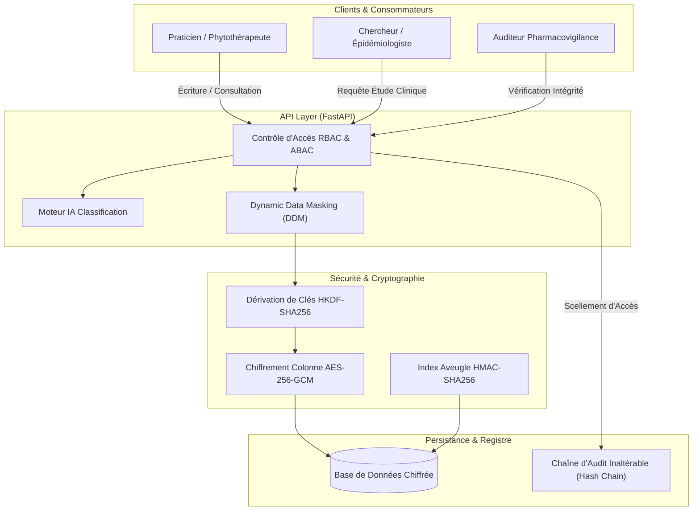

# Architecture Système - Sécurisation des Bases TCIM

## 1. Vue d'Ensemble

La plateforme **Sécurisation des Bases de Données TCIM (Médecine Traditionnelle, Complémentaire & Intégrative)** est conçue selon le paradigme **Zero-Trust** et les exigences du RGPD pour les données de santé à caractère personnel et la pharmacopée sensible.

## 2. Principes Fondamentaux de Sécurité

### 2.1 Chiffrement Granulaire par Colonne (Field-Level Encryption)
Au lieu d'un chiffrement générique au niveau du disque (TDE), chaque colonne médicale (diagnostic, formule galénique, posologie, nom) dérive une clé symétrique unique via **HKDF-SHA256** utilisant un contexte cryptographique `(table:colonne)`.

Le chiffrement est opéré en **AES-256-GCM**, garantissant à la fois la confidentialité et l'authenticité (détection immédiate de toute altération avec tag d'authentification de 16 octets et nonce aléatoire de 12 octets).

### 2.2 Indexation Aveugle (Blind Indexing)
Pour permettre la recherche rapide de dossiers patients sans jamais déchiffrer la base ni stocker d'identifiant en clair, un index aveugle est généré par **HMAC-SHA256** avec une clé de recherche distincte de la clé de chiffrement.

### 2.3 Chaîne d'Audit Cryptographique Inaltérable
Chaque action (`INSERT`, `SELECT`, `UPDATE`, `DELETE`) est scellée dans un registre de blocs chaînés par empreinte SHA-256 :
$$H_i = \text{SHA256}(\text{Index}_i \parallel \text{Timestamp}_i \parallel \text{User}_i \parallel \text{Action}_i \parallel \text{Resource}_i \parallel \text{PayloadFingerprint}_i \parallel H_{i-1})$$

Toute modification rétrospective ou suppression de log est mathématiquement détectable lors de l'audit.

### 2.4 Masquage Dynamique des Données (DDM)
Les chercheurs et épidémiologistes accèdent aux formules galéniques et aux diagnostics agrégés, mais les données nominatives (PII) sont masquées dynamiquement en mémoire sans altérer les enregistrements originaux chiffrés.
